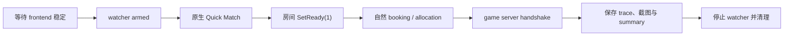

# 从人工接力到自然匹配自动化

2026-07-31

CODOL 恢复项目有一类问题，表面上只是“需要点几下菜单”，实际却会持续吞掉调试时间。客户端要先进入大厅、创建房间、开始匹配，Agent 再及时挂上 watcher、等待目标 packet，并在窗口很短的时候抓取状态。任何一环提前结束，整轮操作都得重来。

最初把这部分交给人操作并不奇怪。AI 不擅长稳定控制游戏 UI，而人很容易完成一次点击。但项目进入反复验证后，这种分工开始失效：人必须一直守着；watcher 可能在点击前超时；即使捕获成功，Agent 也可能没有继续读取结果。真正的问题不再是某个按钮难点，而是整条实验链路没有可靠的生命周期。

## 先把人工操作还原成客户端自己的调用

我们没有从屏幕坐标自动点击开始，而是回到 CODOL i64，寻找进入房间、Quick Match、`SetReady(1)` 和 allocation 相关的原生函数。Frida 可以在正确线程调用这些入口，重现按钮之后的客户端状态变化。

这一步带来两种不同的证据，必须分开记录：

- **Frida 强制调用**证明某个原生入口之后的客户端链路仍然存在；
- **自然链路**要求客户端原有 caller 在真实 room state 和 backend 消息推动下自己进入目标函数。

前者适合探索和缩小范围，后者才适合判断当前恢复链路是否真的接通。于是 `CodolMatchFlow.py` 不只是一个“代替人点按钮”的脚本，它还明确记录 allocation 的来源：`client-native` 或 `frida-forced`。默认 `full` 流程只执行原生 Quick Match、等待房间和 ready，然后观察自然 allocation；只有显式参数才强制 allocation。

## 自动化必须覆盖整个实验，而不是只负责触发

只有原生调用还不够。如果脚本触发后立刻退出，或 watcher 仍要另一个会话手工启动，我们只是把一种人工接力换成了另一种。

`CodolNaturalMatchTrace.py` 因此负责完整生命周期：按需 build/install 和 clean launch，等待本轮 frontend telemetry 与 native globals 稳定，确认 netchan tracer 和 server watcher 都已经 armed，再启动自然匹配；随后持续采样 server state、保存 packet trace 和截图，直到到达明确边界或超时。成功、失败和异常路径都要读取最终状态并停止 watcher。

这次实现也修正了两个很实际的时间假设。自然 allocation 有时约 11 秒出现，有时超过 60 秒；一次 60 秒超时的截图里，房间倒计时还剩 3 秒。固定 25 秒的后置采集同样不可靠，因为截图中倒计时甚至还剩 23 秒。最终编排器不再依赖这些固定等待，而是以 `active_clients`、`gamestate_updates_received` 和 `gamestate_messages_sent` 等状态作为完成门槛，并把默认 allocation timeout 提高到 120 秒。

自动化的价值不只是省去点击。它让同一过程可重复，进而暴露了原先很难稳定复现的竞态。

## 自动化暴露 CCS generation 竞态

一次自然 run 中，game server 在 client readiness 之前看到了 frontend checksum 变化，过早消费了 pending booking，把 `0x396299AA` 冻结进 gamestate。客户端真正执行 compare 时，期望值已经是 `0xF7E89911`，结果自然无法继续。

问题的关键不是“找一个能过的 checksum 写死”，而是恢复 generation 的所有权和时序。`sv_resetServer` 会清空实时 CCS initialized 状态；只有 client 已完成 profile stats、建立 netchan 并进入等待 gamestate 的阶段，主线程才能初始化这一次 generation 的 CCS，然后捕获 live checksum。修复后的 gate 不再把 reset 前或 frontend 阶段的变化当作 booked gamestate。

对应回归测试锁定了这个顺序。最终 clean-process 自然验证中，server 与 client 的 expected/received 都是 `0xF7E89911`，client 上报 `gamestateupdate 6`，server slot 进入 `Active`。

这张图很重要，但也很容易被误读。它证明客户端通过 CCS 校验、解析了当前 gamestate，并来到原生地图加载画面的“等待玩家数据”；它不证明已经存在完整的 authoritative world。此时 client connection state 仍为 `9`，server 还没有发送真正的 initial snapshot。

## 这次迭代留下的东西

我们最终得到的不是一次临时进图，而是一条可以重复运行、能区分证据等级、会保存最终状态并自行清理的自然匹配验证链路。它还把一个原本可能被误解为“checksum 偶尔不对”的问题，收敛成了 CCS generation ownership 和 readiness gate 的明确错误。

下一步边界也因此更清楚：从 CODOL snapshot parser、netfields 和当前 `gamestateupdate 6` 的自然状态出发，恢复最小 server-owned baselines、playerstate/entity state、ack-aware snapshot serialization，以及真正的 server world/frame 生命周期。旧 Python synthetic snapshot 曾经让客户端暂时进图，但黑屏、错误出生位置和低帧率已经说明它只能作为协议探针，不能继续扩展成服务器实现。

这轮还有一个更普遍的经验：当同一人工操作、长时间等待或易丢失的捕获反复出现时，不应该默认把它当作用户必须承担的固定成本。先衡量频率、可行性、风险和维护成本；如果收益明确，就把 build、启动、armed、触发、捕获、分析和清理一起做成可验证的工具链。只有覆盖完整生命周期，自动化才真正让人从实验中离开一会儿，而不是换一个地方继续盯着。
